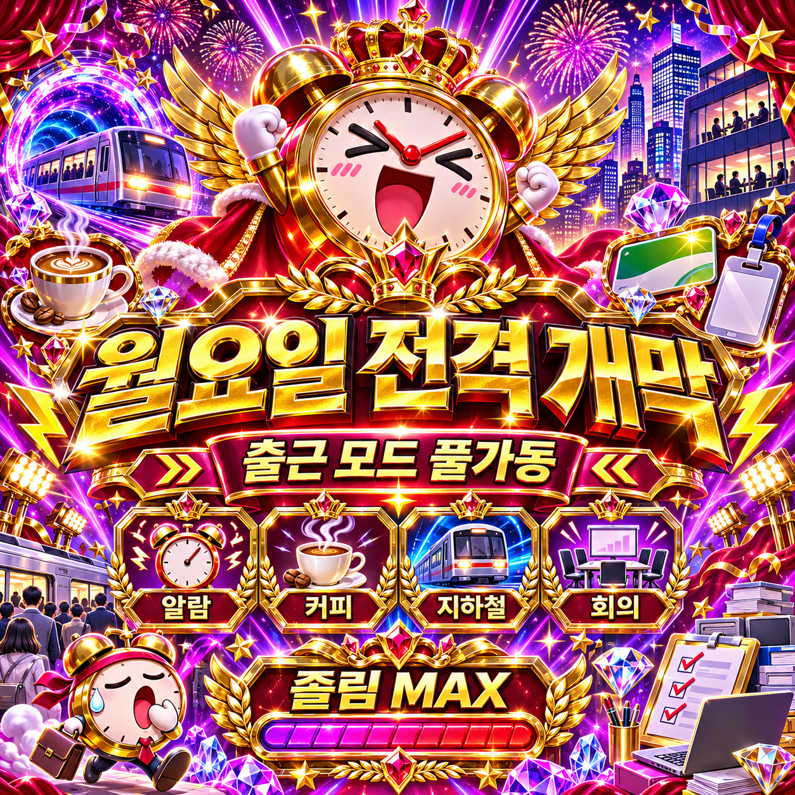

# 개킹받는 한국 광고 이미지 스킬

별일 아닌 일도 **역대급 초대형 VIP 행사**처럼 보이게 만드는 Codex 이미지 스킬입니다. 파칭코 잭팟, 돈키호테 POP, 모바일 MMORPG 이벤트 배너, 심야 홈쇼핑 광고에서 볼 법한 금박 한글과 네온 폭죽을 한 장에 꾹꾹 눌러 담습니다.



## 설치

1. `git clone https://github.com/AIjunja/maximalist-image-skill.git`
2. 저장소 안의 [`maximalist-korean-ad-image`](maximalist-korean-ad-image) 폴더를 Codex의 사용자 스킬 폴더로 복사합니다. 기본 위치는 Windows에서 `%USERPROFILE%\.codex\skills\`, macOS·Linux에서 `~/.codex/skills/`입니다. `CODEX_HOME`을 지정한 환경은 그 아래 `skills` 폴더를 사용하세요.
3. Codex 새 대화에서 `$maximalist-korean-ad-image`를 호출합니다.

## 써보기

```text
$maximalist-korean-ad-image 월요일 출근을 초대형 글로벌 VIP 행사처럼. 제목은 ‘월요일 전격 개막’. 정사각형으로 이미지 만들어줘.
```

```text
$maximalist-korean-ad-image 우리 앱 다크 모드 출시를 MMORPG 전설 등급 업데이트처럼. 기능은 어두운 테마와 자동 전환 두 가지. 4:5 포스터용 프롬프트만 써줘.
```

이미지를 요청하면 사용 가능한 이미지 생성 도구로 만들어요. “프롬프트만”이라고 쓰면 복사할 수 있는 프롬프트를 받습니다.

- [스킬 지침](maximalist-korean-ad-image/SKILL.md)
- [월요일 전격 개막 생성 프롬프트](maximalist-korean-ad-image/references/monday-launch.md)
